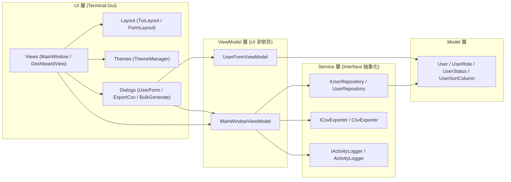

# TuiSample システム仕様書 (`SPEC.md`)

## 1. システム概要と設計方針

本システムは、C# (.NET 10) および `Terminal.Gui` を用いた TUI（Text-based User Interface）ベースのユーザ管理アプリケーションである。以下の3つの設計原則に基づいて構築されている。

1. **UI とビジネスロジックの完全分離（MVVM + DI）**
   - `ViewModels` 層および `Services` 層は `Terminal.Gui` への参照を一切持たない。
   - 状態管理には `CommunityToolkit.Mvvm` の `ObservableObject`（`[ObservableProperty]`, `[RelayCommand]`）を使用し、`PropertyChanged` イベントを介して View と同期する。
2. **座標指定ゼロの宣言的 UI レイアウト (`TuiLayout`)**
   - 各画面（`Views` / `Dialogs`）内で `X = ...`, `Y = ...` といった物理座標を直接指定することを禁止し、`HStack`, `VStack`, `SplitHorizontal`, `DockTopFillBottom`, `FormLayout` を組み合わせて相対・宣言的に画面を構築する。
3. **型安全性とスレッドセーフティ**
   - ロール、ステータス、ソート列などの区分値はすべて `enum` で型安全に扱う。
   - 非同期タスク（バッチ生成等）からの並行アクセスに対し、`.NET 10` の `System.Threading.Lock` と防御的コピー（`Clone()`）によってデータ整合性を保証する。

---

## 2. ドメインモデル仕様 (`Models/`)

### 2.1 `User` エンティティ (`Models/User.cs`)
| プロパティ名 | 型 | 必須 | 初期値 | 説明 |
| :--- | :--- | :---: | :--- | :--- |
| `Id` | `int` | ○ | 自動採番 (`1`〜) | ユーザ一意識別子 |
| `Name` | `string` | ○ | `""` | 氏名（前後の空白はトリム） |
| `Email` | `string` | ○ | `""` | メールアドレス（`@` を含むこと） |
| `Department` | `string` | - | `"未所属"` | 所属部署名（未入力時は `"未所属"` に自動補完） |
| `Role` | `UserRole` | ○ | `UserRole.Viewer` | 権限ロール (`Admin`, `Editor`, `Viewer`) |
| `Status` | `UserStatus` | ○ | `UserStatus.Active` | アカウント状態 (`Active`, `Inactive`) |
| `CreatedAt` | `DateTime` | ○ | `DateTime.Today` | 登録日（表示・CSV出力時は `yyyy-MM-dd` 形式） |

### 2.2 列挙型定義 (`Models/UserEnums.cs`)
- **`UserRole`**: `Admin`（管理者）, `Editor`（編集者）, `Viewer`（閲覧者）
- **`UserStatus`**: `Active`（有効）, `Inactive`（無効）
- **`UserSortColumn`**: `Id`, `Name`, `Department`, `CreatedAt`

---

## 3. 画面・UI 仕様 (`UI/`)

### 3.1 メインウィンドウ (`UI/Views/MainWindow.cs`)
画面は `TuiLayout.DockTopFillBottom` により以下の 3 段構成で配置される（最上部の `MenuBar` と最下部の `StatusBar` を除く）：

1. **上部：検索・絞り込み & アクションツールバー（高さ6行固定）**
   - **1行目（検索・状態フィルタ行）**:
     - 検索キーワード入力 (`TextField`)：入力変更時に即座に一覧を再フィルタリング。
     - `[フィルタ解除]` ボタン：キーワード、状態フィルタ、左ペインのツリー選択をすべて初期状態にリセット（内部的に `_suppressRefresh` により再描画は1回のみ実行）。
     - 状態ラジオボタン (`RadioGroup`)：`All` / `Active` / `Inactive` を水平配置。
   - **2行目（アクションボタン行）**:
     - `[+追加(F2)]`, `[編集(F3)]`, `[-削除(F4)]`, `[CSV出力(F5)]`, `[CSV取込]`, `[一括生成(F8)]`, `[テーマ(F7)]` を水平配置。
2. **中央：メインタブ領域 (`TabView`, 残り高さ `Fill`)**
   - **タブ1 `1.ユーザ管理 (Grid/Tree)`**:
     - `TuiLayout.SplitHorizontal` による左右 2 ペイン構成。
     - **左ペイン（幅26）**: `TreeView` に `すべて (件数)`、`部署別 > 各部署 (件数)`、`ロール別 > 各ロール (件数)` を階層表示。選択変更時に `MainWindowViewModel.ApplyTreeFilter` を呼び出す。
     - **右ペイン（残り幅 `Fill`）**: `TableView` にユーザ一覧を表示。
       - 行条件色分け：`Status == UserStatus.Inactive` の行を暗色（`DarkGray`）で描画。
       - セル条件色分け：`Role == UserRole.Admin` のセルを強調色（`BrightYellow` on `Blue`）で描画。
       - マウス右クリック時に `ContextMenu`（編集 / ステータス切替 / 複製 / 削除）を表示。
   - **タブ2 `2.統計ダッシュボード (Graph)` (`UI/Views/DashboardView.cs`)**:
     - 左ペインに「部署別内訳テーブル（ASCII割合バー付き）」と「ロール別内訳テーブル」を縦積み配置。
     - 右ペインに `GraphView` (`BarSeries`) による部署別ユーザ数の棒グラフを描画。
   - **タブ3 `3.操作ログ (Log)`**:
     - `TextView`（読み取り専用）に `IActivityLogger` の記録を `[HH:mm:ss] [CATEGORY] メッセージ` 形式でリアルタイム表示。
3. **下部：集計サマリバー（高さ1行固定）**
   - `表示: X / 全 Y 件 (Active: Z件) [適用中ツリーフィルタ] | ソート: 列名 ▲/▼` を常時表示。

---

### 3.2 モーダルダイアログ仕様 (`UI/Dialogs/`)

| ダイアログクラス | 起動トリガー | 仕様・バリデーション |
| :--- | :--- | :--- |
| `UserFormDialog` | `F2` (新規追加) / `F3`・`Enter` (編集) | `UserFormViewModel.TryBuildUser` により以下を検証： 1. `氏名` が空白でないこと 2. `メールアドレス` が空白でなく `@` を含むこと 3. `部署` が空白の場合は `"未所属"` を設定 |
| `ExportCsvDialog` | `F5` / メニュー / ボタン | 出力先ファイルパス（デフォルト: `./users_yyyyMMdd_HHmmss.csv`、`SaveDialog` による参照ボタン付き）と出力対象（`現在表示中のユーザのみ` または `全ユーザ`）を選択して CSV 保存を実行。 |
| `BulkGenerateDialog` | `F8` / メニュー / ボタン | `RunGenerationSafeAsync` により、50ms 間隔で 30 件のダミーユーザを非同期生成。`Application.MainLoop.Invoke` 経由で `ProgressBar` と進捗ラベルを更新。実行中は `[中断する]` ボタンで `CancellationTokenSource.Cancel()` による安全な中断が可能。 |

---

## 4. サービス・データ入出力仕様 (`Services/`)

### 4.1 ユーザリポジトリ (`IUserRepository` / `UserRepository`)
- 起動時に初期サンプルデータ 15 件を生成。
- 内部リスト `_users` へのすべての読み書きは `.NET 10` の `System.Threading.Lock` で排他制御し、外部へ返すエンティティはすべて `.Clone()` によるディープコピーを返すことで、UI スレッドとバックグラウンドスレッド間の競合および意図しない参照書き換えを防止する。

### 4.2 CSV 入出力仕様 (`ICsvExporter` / `CsvExporter`)
- **文字エンコーディング**: UTF-8（BOM あり：`new UTF8Encoding(encoderShouldEmitUTF8Identifier: true)`）。Microsoft Excel で直接開いた際の日本語文字化けを防止する。
- **ヘッダー行**: `ID,氏名,メールアドレス,部署,ロール,ステータス,登録日`
- **エスケープ規則（RFC 4180 準拠）**:
  - フィールド値にカンマ (`,`)、ダブルクォート (`"`)、改行 (`\r`, `\n`) が含まれる場合はフィールド全体を `"` で囲み、内部の `"` は `""` にエスケープする。
  - インポート時はクォート内のカンマやエスケープされた `""` を正しく復元し、1行目がヘッダー行である場合は自動スキップする。

---

## 5. カラーテーマ仕様 (`UI/Themes/ThemeManager.cs`)

`F7` キーまたはメニュー操作により、以下の4つのカラースキームを循環切り替えできる：

| インデックス | テーマ名 | 配色特徴 |
| :---: | :--- | :--- |
| `0` | `Classic Blue` | `Terminal.Gui` 標準のブルーベース配色 (`Colors.Base`) |
| `1` | `Dark Cyan` | 黒背景 + ブライトシアン文字のダークモード配色 |
| `2` | `Matrix Green` | 黒背景 + ブライトグリーン文字のグリーンモニター風配色 |
| `3` | `Retro Amber` | 黒背景 + ブライトイエロー/アンバー文字のレトロ端末風配色 |

---

## 6. 単体テスト仕様 (`tests/TuiSample.Tests/`)

| テストクラス | 検証対象 | 主なテストケース |
| :--- | :--- | :--- |
| `MainWindowViewModelTests` | `MainWindowViewModel` / `CsvExporter` | ・キーワード検索と状態フィルタの組み合わせ絞り込み ・`ClearFilter` 実行時に `DisplayedUsers` の変更通知が1回のみ発火すること ・部署ツリー / ロールツリーによる絞り込み ・ソート順のローテーション切替 ・新規追加 / 編集 / ステータストグル / 複製 / 削除の CRUD 一連動作 ・CSV エクスポート（表示中のみ / 全件）と拡張子 `.csv` 自動補完 ・カンマ入り文字列を含む CSV の出力・再パース（Round-Trip）検証 ・部署別 / ロール別統計集計およびダミーユーザ生成ログ検証 |
| `UserFormViewModelTests` | `UserFormViewModel` | ・氏名未入力時のバリデーションエラー検証 ・メールアドレス形式不正時のバリデーションエラー検証 ・前後空白トリムと部署未入力時の `"未所属"` 自動補完検証 ・既存ユーザ編集モード時の初期値セット検証 |
| `TuiLayoutTests` | `TuiLayout` / `FormLayout` | ・`HStack` による水平方向チェーン配置検証 ・`VStack` による垂直方向チェーン配置検証 ・`SplitHorizontal` による左右 2 ペイン分割検証 ・`FormLayout` によるラベル＋入力コントロール自動配置検証 |

